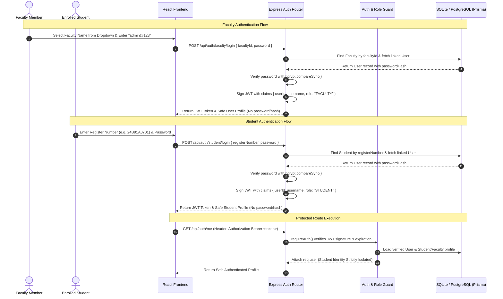

# MID TRACK – Authentication Architecture & Security (Module 4)
**S.R.K.R. Engineering College (Autonomous), Bhimavaram**
*Role-Based Authentication & Identity Isolation System*

---

## 1. Authentication Architecture Overview

---

## 2. Authentication Endpoints

| Endpoint | Method | Access | Description | Input Parameters | Safe Response |
|---|---|---|---|---|---|
| `/api/auth/faculty` | `GET` | Public | Retrieves all 23 faculty names and IDs for the login dropdown | None | `{ count: 23, faculty: [{ facultyId, name, department }] }` |
| `/api/auth/faculty/login` | `POST` | Public | Authenticates faculty member using EMPID and password | `{ facultyId, password }` | `{ token: "...", user: { id, name, role: "FACULTY", department } }` |
| `/api/auth/student/login` | `POST` | Public | Authenticates student using University Register Number | `{ registerNumber, password }` | `{ token: "...", user: { id, name, role: "STUDENT", section, semester } }` |
| `/api/auth/me` | `GET` | Authenticated | Retrieves current user identity from verified JWT token | Bearer Token in Header | `{ user: { id, username, role, name, studentProfile / facultyProfile } }` |
| `/api/auth/logout` | `POST` | Public | Stateless token discard acknowledgement | None | `{ success: true, message: "Logged out successfully." }` |

---

## 3. Security & Isolation Rules

1. **Strict Two-Role System**:
   - Only `FACULTY` and `STUDENT` roles exist. Zero Super Admin, Admin, or HOD roles.
2. **Zero Plaintext Passwords**:
   - All passwords in `users.password_hash` are secured using `bcrypt` (10 salt rounds).
   - Faculty password (`admin@123`) is stored exclusively as a salted Bcrypt hash.
   - Student initial passwords (`Register Number`) are stored exclusively as salted Bcrypt hashes.
3. **Student Identity Protection & Cross-Student Isolation**:
   - Authenticated student requests derive the student's ID strictly from the verified JWT payload (`req.user.id`).
   - A student can never view or modify another student's marks by altering a URL or request parameter.
4. **Authoritative Backend Role Validation**:
   - If a student tries to authenticate at the faculty endpoint, or vice-versa, the request is rejected with generic authentication error messages preventing user enumeration.
5. **Sanitized Error Responses**:
   - Invalid credentials consistently return `"Invalid username or password."` without revealing whether an EMPID or register number exists.
