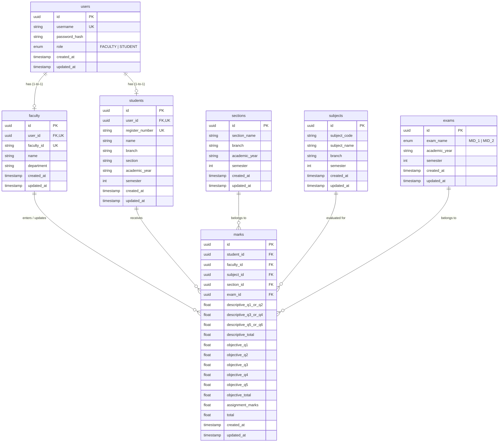

# MID TRACK – Database Schema Specification (Module 2)
**S.R.K.R. Engineering College (Autonomous), Bhimavaram**
*PostgreSQL Database Relational Schema*

---

## 1. Relational Entity-Relationship (ER) Overview

---

## 2. Table Specifications & Constraints

### A. `users` Table
- **Purpose**: Centralized authentication table.
- **Constraints**:
  - `id`: Primary Key (UUID)
  - `username`: Unique (Student Roll Number or Faculty Login ID)
  - `role`: Enum (`FACULTY`, `STUDENT`) — *Strictly no Super Admin*
  - `password_hash`: Bcrypt hashed password

### B. `faculty` Table
- **Purpose**: Profile information for teaching staff.
- **Constraints**:
  - `id`: Primary Key (UUID)
  - `user_id`: Foreign Key referencing `users(id)` with `ON DELETE CASCADE`, Unique
  - `faculty_id`: Unique staff identifier (e.g. `FAC101`)
  - `name`: Faculty Full Name (used in the login dropdown)

### C. `students` Table
- **Purpose**: Enrolled student records.
- **Constraints**:
  - `id`: Primary Key (UUID)
  - `user_id`: Foreign Key referencing `users(id)` with `ON DELETE CASCADE`, Unique
  - `register_number`: Unique registration number (e.g. `23CS001`)
  - Indexes: `[branch, section, semester, academic_year]` for fast lookup during marks entry

### D. `sections` Table
- **Purpose**: Academic sections per branch and academic period.
- **Unique Constraint**: `(section_name, branch, academic_year, semester)`

### E. `subjects` Table
- **Purpose**: Course curriculum subjects per semester and department.
- **Unique Constraint**: `(subject_code, branch, semester)`

### F. `exams` Table
- **Purpose**: Examination period records (`MID_1` and `MID_2`).
- **Unique Constraint**: `(exam_name, academic_year, semester)`

### G. `marks` Table
- **Purpose**: Detailed question-wise marks storage and component totals.
- **Question Structure**:
  - **Descriptive (Max 15)**: `descriptive_q1_or_q2` (0-5), `descriptive_q3_or_q4` (0-5), `descriptive_q5_or_q6` (0-5) $\rightarrow$ `descriptive_total` (0-15)
  - **Objective (Max 10)**: `objective_q1` to `objective_q5` (0-2 each) $\rightarrow$ `objective_total` (0-10)
  - **Assignment (Max 5)**: `assignment_marks` (0-5)
  - **Grand Total (Max 30)**: `total` (0-30)
- **Unique Constraint**:
  - `@@unique([student_id, subject_id, exam_id])`
  - Ensures exactly 1 record per student per subject per mid exam, preventing duplicate marks insertion and enabling clean updates.
